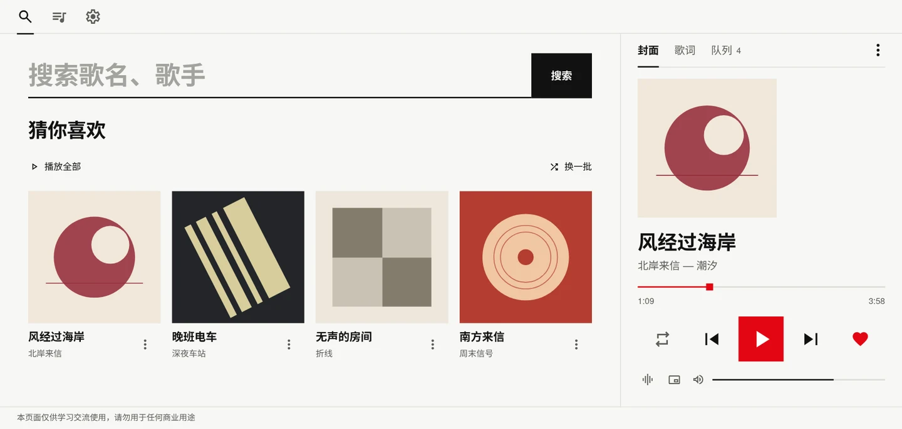

  

<h1 align="center">Listening</h1>

<strong>在一个播放器里搜索和播放网易云音乐与 QQ 音乐</strong>

网页版 · 可安装的 PWA · 安卓 APK

  
  

  <a href="#快速开始">快速开始</a> ·
  <a href="#功能">功能</a> ·
  <a href="#安卓-apk">安卓 APK</a> ·
  <a href="#部署">自托管</a> ·
  <a href="#开发相关">开发文档</a>

  
   
  桌面网页版 · 首页推荐与播放面板（示例曲目与封面）

## 快速开始

**安卓** · [下载最新正式版 APK](https://github.com/fenghanyue/Listening/releases/latest/download/listening.apk)，在手机上打开安装包。[安装与升级说明](#安卓-apk)

**网页版** · 建议使用 Node.js 22 或 24 LTS。仓库已包含网页所需的依赖和打包产物，启动前无需安装 npm 依赖。

~~~bash
git clone https://github.com/fenghanyue/Listening.git
cd Listening
npm start
~~~

浏览器打开 <http://localhost:4444>。支持安装 PWA 的浏览器可从地址栏或菜单把它添加到桌面或主屏幕。

## 功能

| 功能 | 使用方式 |
| --- | --- |
| **聚合搜索** | 并行搜索网易云音乐和 QQ 音乐，按音源交错展示结果，支持单独筛选音源。 |
| **歌词与播放** | 支持进度拖动、音量调节、列表循环、随机和单曲循环。宽屏可同时显示浏览区、播放器和歌词。 |
| **歌单与队列** | 建立歌单、收藏曲目、重排播放队列。队列里的 × 只移出当前队列。分享单曲可复制歌曲信息和可用的官方歌曲页链接。 |
| **离线缓存** | 「已缓存」列出可离线播放的歌曲。歌单里的「缓存全部」可提前下载，设置里的「只播已缓存」可限制播放范围。 |
| **首页推荐** | 「猜你喜欢」结合收藏、歌单和有效收听生成推荐。可选择配置 OpenAI 兼容的 HTTPS 服务，生成并缓存一批候选歌曲。 |
| **迷你播放器** | 桌面 Chrome / Edge 支持置顶播放小窗，可以切歌、查看和调整播放队列。 |
| **语言与主题** | 设置中可选择中文或 English、浅色或深色主题。 |

### 歌单备份与离线播放

- **导入歌单**支持网易云分享链接、整段分享文本和本项目的导出字符串。填入新名称会新建歌单，填入同名会替换旧歌单，留空或填写「喜欢的音乐」会整体替换收藏。QQ 音乐歌单链接暂未支持。
- **网页与 APK 分别存储数据**。迁移歌单可使用「导出歌单」和「导入」，音频缓存需在新客户端重新下载。
- **网页打开后**可以播放已缓存曲目。需要断网启动播放器时，可使用 APK。缓存大小可在设置中调整，默认网页 300 MB、APK 2 GB。

[推荐与 AI 配置](docs/recommendations.md) · [迷你播放器使用说明](docs/mini-player.md)

## 安卓 APK

| 场景 | 安卓版能力 |
| --- | --- |
| **后台播放** | 通知栏和锁屏控制、蓝牙耳机按键、拔耳机暂停、锁屏后连续播放。 |
| **桌面与车载** | 2×2 桌面挂件可切歌、暂停和切换播放模式。「设置 → 车载蓝牙」可开启逐句歌词，默认关闭，显示效果取决于车机。 |
| **安装与更新** | App 内可检查更新。同一签名的新版可直接覆盖安装并保留数据，卸载会清空本地数据。 |

Android 版通过 Capacitor 打包同一套网页资源，支持沉浸式状态栏和系统分享。GitHub Actions 在 main 分支收到相关文件改动时构建，配置签名后发布正式版。[安卓使用与构建指南](docs/android-app.md) · [APK 构建工作流](.github/workflows/android.yml)

## 部署

在支持 Node.js 的环境中部署仓库，启动命令为 `npm start`。[server.mjs](server.mjs) 同时提供静态页面、跨域请求代理和网页端 AI 推荐转发。服务读取 `PORT` 环境变量，默认端口为 `4444`，部署时需保留 `examples/` 和 `server/`。

可以直接启动仓库自带的前端产物。若修改了 `src/api/`，先运行 `npm run build` 更新 `examples/api-bundle.js`。

## 开发相关

| 路径 | 内容 |
| --- | --- |
| [examples/](examples/) | 网页和 APK 共用的播放器页面、PWA、字体与前端依赖。 |
| [src/api/](src/api/) | 音乐搜索、播放详情、推荐、曲目信息和分享。 |
| [server.mjs](server.mjs) · [server/](server/) | 网页入口、跨域请求代理和 AI 推荐转发。 |
| [mobile/](mobile/) | Capacitor 工程、Android 原生功能和 APK 构建。 |
| [tests/](tests/) · [docs/](docs/) | 自动测试和各功能的详细说明。 |

~~~bash
npm run build # 更新浏览器用的 API 打包产物
npm test      # 运行自动测试
~~~

- **页面资源**放在 `examples/vendor/`。APK 构建会检查外链脚本、样式和字体，确保离线可以加载页面。使用 `node scripts/vendor-assets.mjs` 更新依赖，用 `node scripts/vendor-assets.mjs icons` 重建 Material Symbols 字体。
- **翻译和图标**分别由 `node tests/i18n.test.mjs` 和 `node tests/run.mjs icons` 检查。新增界面文案时，在页面的 `STRINGS` 表里同时添加中文和英文。
- **QQ 曲目信息**由 `fetchQQMetadata` 按需补充封面与专辑，播放链接由 `fetchQQDetails` 获取。[曲目资料说明](docs/recommendations.md#qq-展示资料)
- **切歌诊断**可在设置中点「复制切歌诊断记录」。最近 200 条记录保存在本机，包含选曲与缓存路径、出声耗时、重试以及前后台和网络变化。
- **安卓原生功能**按 `IS_NATIVE` 判断启用。网页端 AI 推荐由服务转发，APK 通过原生 HTTP 请求用户配置的模型服务。[状态栏实现](docs/mobile-status-bar.md) · [AI 请求路径](docs/recommendations.md#数据与请求路径)

Playwright 的安装方式和单项测试命令见 [自动测试说明](tests/README.md)。

## 单独使用搜索 / 播放 API

[src/api/](src/api/) 可独立于播放器界面使用。`searchAll` 默认同时搜索网易云音乐与 QQ 音乐，结果按音源交错返回。[Node.js 完整示例](examples/node-demo.mjs)

~~~js
import { searchAll, ensureTrackDetails } from './src/api/index.js';
import { parseLRC } from './src/api/utils.js';

const tracks = await searchAll({ keyword: '周杰伦', limit: 10 });

if (tracks.length) {
  const track = await ensureTrackDetails(tracks[0]);
  console.log(track.audioUrl, track.qualityLabel);
  console.log(parseLRC(track.lrc));
}
~~~

单源搜索、网易云歌单与曲目字段

~~~js
import { searchNetease, searchQQ, fetchNeteasePlaylist } from './src/api/index.js';

const neteaseTracks = await searchNetease('关键词', 1, 10);
const qqTracks = await searchQQ('关键词', 10);
const playlistTracks = await fetchNeteasePlaylist('36420739');
~~~

| 字段 | 用途 |
| --- | --- |
| `uid`、`source` | 曲目标识和音源，例如 `netease-123456` 与 `netease`。 |
| `title`、`artist`、`album`、`cover` | 歌名、歌手、专辑和可能为空的封面地址。 |
| `audioUrl`、`lrc`、`detailsLoaded` | 播放地址、LRC 歌词和详情加载状态。 |
| `quality`、`qualityLabel` | 音质标记与显示名称，取值随音源而异。 |

官方歌曲页链接与分享文本

| 音源 | 地址来源 |
| --- | --- |
| 网易云音乐 | 用纯数字 `songid` 拼出官方移动歌曲页地址。 |
| QQ 音乐 | 优先用详情里的 `track.pageUrl`，再用歌曲 MID 拼出官方歌曲页地址。 |
| SoundCloud | 使用 `track.scPermalink`。 |

`officialSongUrl(track)` 构造官方歌曲页地址。地址不可用时，`shareText(track)` 仍会生成歌曲信息文本。浏览器系统分享使用 `navigator.share({ text })`。[分享实现](src/api/share.js)

### 第三方音源

| 音源 | 上游 | 用途 |
| --- | --- | --- |
| 网易云音乐 | `api.qijieya.cn` | 搜索、详情、歌单。 |
| QQ 音乐 | `tang.api.s01s.cn` | 搜索、展示资料、播放详情。 |
| SoundCloud | `api-v2.soundcloud.com` | 兼容已有歌单、收藏和队列中的旧曲目，在线播放取决于上游可用性。 |

旧 SoundCloud 曲目可导入、导出，有缓存时可离线播放。需要排查上游接口时，可在浏览器控制台显式调用 `ListeningAPI.searchAll({ keyword: 'lofi', sources: ['soundcloud'] })`。

---

本项目仅供学习交流使用，请勿用于商业用途。音频版权归原平台及版权方所有。
